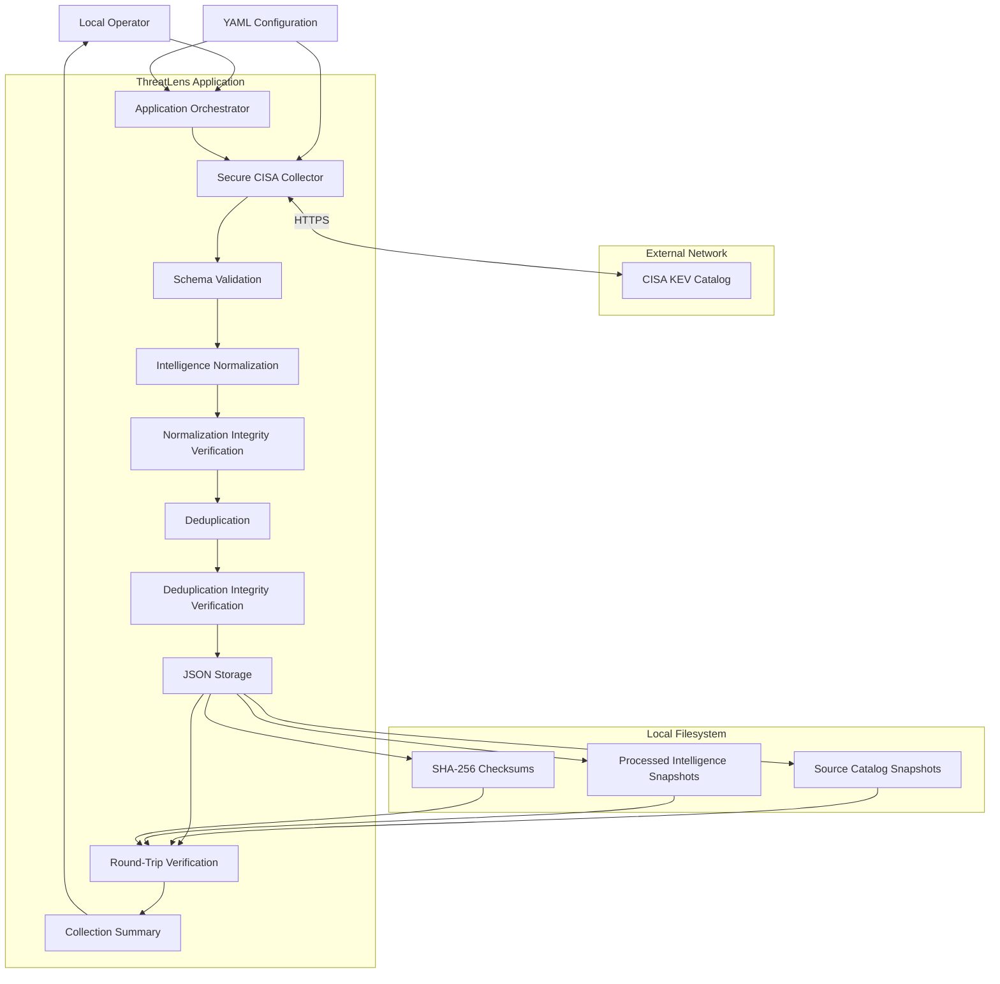
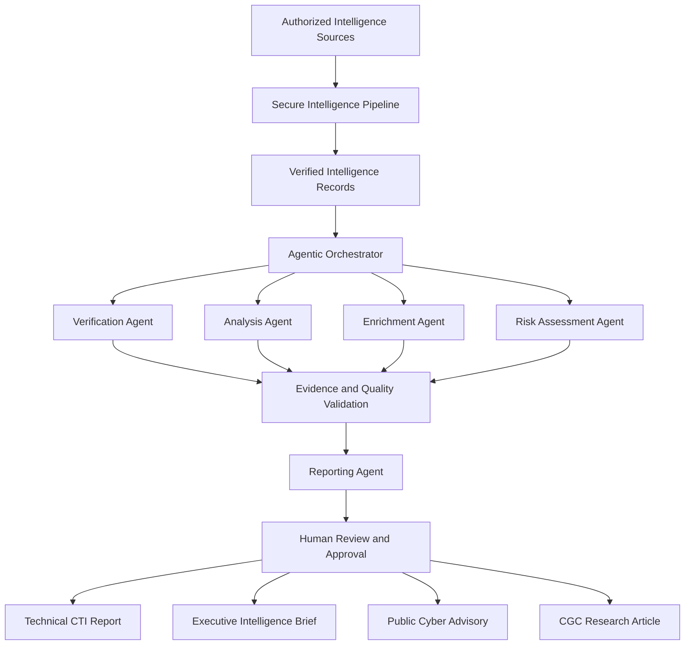

# ThreatLens — System Architecture

## 1. Document Information

| Attribute | Value |
|---|---|
| Project | ThreatLens |
| Version | 0.1.0 |
| Organization | Cyber Grad Chronicles |
| Architecture | Modular Python application |
| Environment | Local development |
| Document date | November 25, 2026 |
| Status | Foundational MVP |

## 2. System Overview

ThreatLens is a security-focused cyber threat intelligence platform designed to automate intelligence collection, validation, processing, analysis, and reporting.

The foundational MVP establishes a deterministic intelligence pipeline before introducing large language models, autonomous agents, external tools, or automated publishing.

This approach establishes a validated data foundation and measurable security baseline against which future AI functionality can be evaluated.

## 3. Architecture Principles

- Security by design
- Defense in depth
- Least privilege
- Explicit source authorization
- Untrusted external input handling
- Data integrity and provenance preservation
- Deterministic processing
- Fail-closed behavior for detected validation failures
- Separation of responsibilities
- Human oversight for future AI-generated intelligence
- Test-driven security engineering

## 4. Current System Architecture



## 5. Component Responsibilities

| Component | Implementation | Responsibility |
|---|---|---|
| Application orchestration | main.py | Coordinates pipeline execution and integrity verification |
| Configuration management | src/config_loader.py | Loads configuration and validates authorized sources |
| Intelligence collection | src/collectors/cisa_collector.py | Retrieves and validates external vulnerability intelligence |
| Intelligence schemas | src/schemas/intelligence.py | Defines structured and validated data models |
| Normalization | src/processing/normalizer.py | Converts source intelligence into standardized records |
| Deduplication | src/processing/deduplicator.py | Removes duplicate records while preserving source distinctions |
| Persistence | src/storage/json_storage.py | Stores and reloads intelligence snapshots |
| Automated verification | tests/ | Validates functionality, security controls, and failure behavior |

## 6. Intelligence Collection

The foundational MVP retrieves intelligence from the Cybersecurity and Infrastructure Security Agency Known Exploited Vulnerabilities catalog.

### Authorized Sources

| Source | Status | Trust Classification |
|---|---|---|
| CISA KEV | Enabled | High |
| NIST NVD | Disabled | High |
| CISA Cybersecurity Advisories | Disabled | High |

Trust classifications represent configured source reputation. They do not establish the accuracy, authenticity, or safety of every individual intelligence claim.

All external content remains untrusted regardless of source classification.

### Collection Controls

- HTTPS-only source validation
- Explicit hostname allowlisting
- Standard HTTPS port restrictions
- Prohibition of embedded URL credentials
- Disabled automatic redirects
- TLS certificate verification
- Disabled environment-derived HTTP proxy configuration
- Bounded retries and retry delays
- Response size restrictions
- Content type validation
- Content encoding restrictions
- Content-Length validation
- Duplicate JSON key rejection
- Invalid JSON constant rejection
- Schema validation
- Duplicate CVE detection
- Catalog count verification

### Resource Limits

| Setting | Configured Value |
|---|---|
| HTTP request timeout | 30 seconds |
| Maximum retries | 3 |
| Maximum collection attempts | 4 |
| Initial retry delay | 2 seconds |
| Maximum response size | 20 MiB |
| Automatic redirects | Disabled |
| TLS verification | Enabled |

The configured HTTP timeout is not a guaranteed end-to-end execution deadline.

## 7. Intelligence Processing

### Normalization

Validated source records are converted into standardized intelligence objects.

Normalization preserves:

- CVE identifiers
- Vulnerability titles and descriptions
- Vendor and product information
- Known exploitation status
- Ransomware campaign association
- Remediation requirements
- Remediation deadlines
- Source notes and references
- CWE classifications
- Source identifiers
- Source catalog versions
- Source publication timestamps
- Collection timestamps

Deterministic UUIDs provide consistent source-specific record identities.

Unknown severity remains explicitly classified as unknown rather than inferred without supporting evidence.

### Deduplication

Deduplication operates on standardized record identities.

The most recently collected record is retained when duplicate identities are encountered. Records from different sources remain distinguishable.

When collection timestamps are identical, the first encountered record is retained.

### Integrity Verification

Application-level verification checks normalized records against their source data and verifies deduplication results against an independent processing baseline.

Detected inconsistencies prevent the application from reporting successful execution.

## 8. Intelligence Storage

The foundational MVP uses local JSON snapshots rather than a database.

```text
data/
├── raw/
│   ├── cisa_kev_<timestamp>_<uuid>.json
│   └── cisa_kev_<timestamp>_<uuid>.sha256
└── processed/
    ├── intelligence_<timestamp>_<uuid>.json
    └── intelligence_<timestamp>_<uuid>.sha256
```

Storage controls include:

- Unique snapshot filenames
- Atomic individual file writes
- SHA-256 checksum generation
- Checksum verification before data acceptance
- Path traversal restrictions
- Snapshot size restrictions
- JSON structure validation
- Schema validation during reload
- Existing snapshot overwrite prevention
- Round-trip content verification

Source catalog snapshots represent validated source data serialized into JSON. They are not necessarily byte-for-byte copies of the original HTTP response.

SHA-256 checksums detect content changes relative to the stored checksum. They do not provide digital signatures or independent source authentication.

Individual atomic writes do not make the entire collection run transactional.

## 9. Trust Boundaries

### TB-01: External Network Boundary

Separates external intelligence providers from the local ThreatLens application.

External responses must pass transport, source authorization, resource, and schema validation controls.

### TB-02: External Data Processing Boundary

Separates externally supplied content from internal structured intelligence.

External content is treated as data rather than executable instructions.

### TB-03: Filesystem Boundary

Separates in-memory intelligence processing from persistent local storage.

Stored intelligence must undergo checksum and schema verification before acceptance.

### TB-04: Operator and Configuration Boundary

Separates application execution from operator-controlled configuration, dependencies, environment variables, and local permissions.

The foundational MVP assumes a trusted local operator and operating environment.

### TB-05: Future AI Execution Boundary

Reserved for future LLM integrations, agent orchestration, retrieval systems, and tool execution.

This boundary is not active in version 0.1.0.

## 10. Error Handling and Logging

The application uses controlled exception handling and categorized exit codes.

| Exit Code | Meaning |
|---|---|
| 0 | Successful execution |
| 1 | Configuration failure |
| 2 | Collection failure |
| 3 | Storage failure |
| 4 | Pipeline integrity failure |
| 5 | Unexpected application failure |
| 130 | Operator interruption |

Logging provides operational visibility while restricting sensitive exception details.

Logs are not currently designed as immutable or independently authenticated audit records.

## 11. Technology Stack

### Implemented

| Technology | Purpose |
|---|---|
| Python 3.12.10 | Application runtime |
| HTTPX | HTTP collection |
| Pydantic | Data modeling and validation |
| PyYAML | Configuration loading |
| JSON | Intelligence persistence |
| SHA-256 | Snapshot integrity checking |
| Pytest | Automated testing |
| RESPX | Mocked HTTP testing |
| Coverage.py / pytest-cov | Statement and branch coverage |
| Bandit | Static application security testing |
| Git / GitHub | Version control |

### Planned

| Technology | Purpose |
|---|---|
| OpenAI API or alternative LLM provider | AI-assisted analysis |
| LangGraph | Agentic orchestration |
| SQLite | Structured historical intelligence storage |
| Feedparser | RSS collection |
| Streamlit | Intelligence dashboard |
| GitHub Actions | Continuous integration |
| Docker | Reproducible deployment |
| n8n | Optional scheduled automation |

## 12. Verification Baseline

Assessment date: November 25, 2026.

| Metric | Result |
|---|---:|
| Automated tests passed | 231 |
| Functional test cases | 65 |
| Security-focused test cases | 166 |
| Statement coverage | 99% |
| Branch coverage | 99% |
| Combined coverage | 99% |
| Executable statements | 574 |
| Uncovered statements | 4 |
| Bandit lines scanned | 1,260 |
| Bandit findings | 0 |
| Live intelligence records collected | 1,805 |
| Live intelligence records verified | 1,805 |
| Live execution time | 2.45 seconds |
| Application exit code | 0 |

These measurements establish the tested foundational baseline and do not constitute a guarantee of security.

## 13. Future Agentic Architecture



Future AI components must operate within explicitly defined permissions, resource budgets, data handling restrictions, and approval boundaries.

Retrieved intelligence must never be granted instructional authority over agents or tools.

## 14. Architecture Limitations

- Only one intelligence source is currently implemented.
- Cross-source claim verification is not implemented.
- Historical intelligence correlation is not implemented.
- Snapshot persistence is not transactional across an entire run.
- Failed-run snapshots may remain on disk.
- Checksums are not cryptographic signatures.
- Network-level egress restrictions are not implemented.
- Local filesystem security depends partly on operating system permissions.
- AI analysis and agent execution are not implemented.
- Automated publishing is not implemented.
- Production deployment has not been evaluated.

## 15. Architecture Evolution

The foundational MVP establishes a deterministic, security-tested intelligence pipeline.

Future development will extend this foundation through AI-assisted analysis, specialized agents, evidence-backed reporting, adversarial evaluations, and human-supervised intelligence workflows.

Architecture changes must be accompanied by updated threat models, regression tests, and documented security decisions.