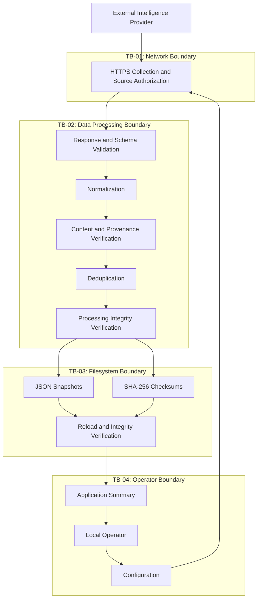

# ThreatLens — Security Threat Model

## 1. Document Information

| Attribute | Value |
|---|---|
| Project | ThreatLens |
| Version | 0.1.0 |
| Organization | Cyber Grad Chronicles |
| Assessment date | November 25, 2026 |
| Methodology | STRIDE |
| Risk assessment | Qualitative likelihood-impact matrix |
| Environment | Local development |
| Status | Initial threat model |

## 2. Executive Summary

ThreatLens is a security-focused cyber threat intelligence platform designed to collect, validate, normalize, process, and ultimately analyze external cybersecurity intelligence.

The foundational MVP establishes a deterministic intelligence pipeline with explicit source authorization, controlled network communication, structured input validation, integrity verification, secure persistence, and automated security testing.

The threat model evaluates risks associated with the currently implemented architecture while identifying additional threats introduced by future AI and agentic capabilities.

Security is treated as a continuous engineering responsibility rather than a one-time implementation milestone.

## 3. Assessment Objectives

- Identify protected assets and security requirements.
- Define system trust boundaries.
- Identify potential adversaries and attack surfaces.
- Evaluate threats using STRIDE.
- Document implemented security controls.
- Establish traceability between threats, controls, and automated tests.
- Identify residual risks and limitations.
- Establish security requirements for future AI integration.

## 4. Scope

### In Scope

- Local Python application
- Application orchestration
- YAML configuration management
- External intelligence collection
- HTTP communication
- Source authorization
- JSON parsing
- Intelligence schemas
- Normalization
- Deduplication
- Local snapshot storage
- Checksum verification
- Application logging
- Dependency management
- Automated testing
- Source code management

### Outside Current Implementation Scope

- LLM inference
- Autonomous agents
- External agent tools
- Vector databases
- Public-facing APIs
- Multi-user authentication
- Cloud infrastructure
- Automated publishing
- Production deployment

Future functionality requires additional threat modeling before deployment.

## 5. Security Assumptions

- The local operator is authorized to execute ThreatLens.
- The operating system and Python runtime are reasonably maintained.
- Local configuration and source code are controlled by the operator.
- External intelligence providers may return malformed, inaccurate, compromised, or adversarial content.
- Trusted source classifications do not eliminate the requirement for validation.
- Network communication may be interrupted or manipulated.
- Stored intelligence may be modified after collection.
- Dependencies may contain vulnerabilities or become compromised.
- Future AI systems may interpret malicious intelligence as instructions unless appropriate controls are implemented.

## 6. Protected Assets

| Asset ID | Asset | Primary Security Requirement |
|---|---|---|
| A-01 | Intelligence source configuration | Integrity |
| A-02 | Application source code | Integrity |
| A-03 | Collected source intelligence | Integrity and availability |
| A-04 | Normalized intelligence records | Integrity |
| A-05 | Source provenance metadata | Integrity |
| A-06 | Stored JSON snapshots | Integrity and availability |
| A-07 | SHA-256 checksums | Integrity |
| A-08 | Application logs | Integrity and confidentiality |
| A-09 | Local filesystem | Confidentiality and integrity |
| A-10 | Runtime resources | Availability |
| A-11 | Dependencies and development environment | Integrity |
| A-12 | Future API credentials | Confidentiality |
| A-13 | Future AI-generated intelligence | Integrity |
| A-14 | Future agent permissions | Integrity and authorization |

## 7. Security Objectives

### Confidentiality

Prevent unauthorized exposure of credentials, local filesystem contents, environment variables, and sensitive operational information.

### Integrity

Preserve intelligence content, source provenance, record identities, and processing consistency throughout the application lifecycle.

### Availability

Restrict resource consumption and handle collection failures without uncontrolled retries or indefinite processing.

### Accountability

Maintain sufficient operational visibility to identify application failures and reconstruct collection activities where supported by available logs and snapshots.

### Authorization

Restrict intelligence collection to explicitly authorized sources and prevent future AI components from exceeding assigned permissions.

## 8. Potential Threat Actors

| Threat Actor | Potential Objective |
|---|---|
| External malicious actor | Manipulate intelligence or disrupt collection |
| Compromised intelligence provider | Distribute misleading or adversarial content |
| Malicious dependency maintainer | Introduce unauthorized behavior through software dependencies |
| Local unauthorized user | Modify snapshots, configuration, or source code |
| Accidental operator | Introduce configuration errors or mishandle sensitive information |
| Future prompt injection attacker | Manipulate LLM behavior through retrieved intelligence |

## 9. Attack Surface

| Surface | Exposure |
|---|---|
| External HTTPS endpoints | Malicious or compromised responses |
| Source registry | Unauthorized destination configuration |
| YAML parser | Malformed or unsafe configuration |
| HTTP response headers | Invalid lengths, encodings, and redirects |
| JSON parser | Malformed structures and ambiguous data |
| Intelligence schemas | Invalid or oversized field values |
| Normalization | Data loss or unauthorized content changes |
| Deduplication | Incorrect record removal or replacement |
| Local filesystem | Unauthorized reads, writes, or path manipulation |
| Snapshot checksums | Modification of both data and verification metadata |
| Application logging | Sensitive information disclosure |
| Python dependencies | Software supply chain compromise |
| Git repository | Accidental credential or generated data exposure |
| Future LLM interfaces | Prompt injection and unsupported intelligence |
| Future agent tools | Excessive permissions and unauthorized execution |

## 10. Trust Boundaries

| Boundary ID | Boundary | Security Consideration |
|---|---|---|
| TB-01 | External network to application | Source authorization and transport security |
| TB-02 | External content to internal processing | Input validation and structured data handling |
| TB-03 | Application to local filesystem | Controlled persistence and integrity verification |
| TB-04 | Operator to application configuration | Configuration integrity and local permissions |
| TB-05 | Future intelligence-to-AI boundary | Instruction separation and prompt injection defense |
| TB-06 | Future agent-to-tool boundary | Least privilege and execution authorization |
| TB-07 | Future reporting-to-publication boundary | Human review and disclosure prevention |

TB-05 through TB-07 are planned boundaries and are not active in the foundational MVP.

## 11. Data Flow Diagram

## 12. Risk Assessment Methodology

Threats are classified using STRIDE:

- Spoofing
- Tampering
- Repudiation
- Information Disclosure
- Denial of Service
- Elevation of Privilege

Likelihood and impact are assessed qualitatively as Low, Medium, or High.

| Likelihood / Impact | Low | Medium | High |
|---|---|---|---|
| High | Medium | High | Critical |
| Medium | Low | Medium | High |
| Low | Low | Low | Medium |

Inherent risk represents the estimated risk before application-specific mitigations.

Residual risk represents the estimated remaining risk after considering implemented controls.

Risk ratings are preliminary engineering judgments and are not statistically measured probabilities.

## 13. STRIDE Threat Assessment

### 13.1 Spoofing

#### S-01: Unauthorized Intelligence Source

An attacker or configuration error directs collection toward an unauthorized intelligence provider.

**Potential impact:** False intelligence, unauthorized network access, or data poisoning.

**Implemented controls:**

- Explicit source registry
- HTTPS requirement
- Exact hostname allowlisting
- Standard port restrictions
- Embedded credential rejection
- Disabled redirects
- TLS certificate verification
- Collection-time URL validation

**Residual risk:** Compromised DNS infrastructure, certificate trust infrastructure, authorized providers, or local configuration may undermine source trust.

**Inherent risk:** High

**Residual risk:** Medium

#### S-02: False Source Provenance

An intelligence record is assigned incorrect source identifiers, publication timestamps, catalog versions, or record identities.

**Implemented controls:**

- Structured source metadata
- Deterministic record identities
- Application-level provenance verification
- Normalization integrity testing

**Residual risk:** A compromised authorized provider may distribute inaccurate intelligence that passes structural validation.

**Inherent risk:** High

**Residual risk:** Medium

### 13.2 Tampering

#### T-01: Malformed or Ambiguous Intelligence

An external provider supplies malformed JSON, duplicate keys, invalid constants, duplicate CVEs, or inconsistent catalog metadata.

**Implemented controls:**

- JSON parsing validation
- Duplicate key rejection
- Invalid constant rejection
- Pydantic schema validation
- Catalog count verification
- Duplicate CVE rejection

**Residual risk:** Structurally valid but misleading intelligence may remain undetected.

**Inherent risk:** High

**Residual risk:** Medium

#### T-02: Intelligence Modification During Processing

Normalized records are modified, omitted, duplicated, or assigned inconsistent identities.

**Implemented controls:**

- Source-to-normalized content verification
- Deterministic identity verification
- Source provenance verification
- Independent deep-copy verification baseline
- Deduplication consistency checks
- Controlled integrity failure handling

**Residual risk:** Verification logic shares the same runtime and application trust boundary as processing logic.

**Inherent risk:** High

**Residual risk:** Medium

#### T-03: Stored Intelligence Modification

Stored snapshots are modified after collection.

**Implemented controls:**

- SHA-256 checksum generation
- Checksum verification
- Schema validation during reload
- Round-trip content verification
- Existing snapshot overwrite prevention

**Residual risk:** An attacker with sufficient filesystem access may modify both a snapshot and its checksum.

**Inherent risk:** High

**Residual risk:** Medium

#### T-04: Partial or Incomplete Persistence

An interrupted or failed collection run leaves incomplete or unverified snapshots on disk.

**Implemented controls:**

- Atomic individual file writes
- Checksum write failure cleanup
- Storage exception handling
- Round-trip verification
- Failure exit codes

**Residual risk:** The complete collection run is not transactional. A downstream consumer could incorrectly accept an artifact from a failed run.

**Inherent risk:** High

**Residual risk:** Medium

**Required future treatment:** Introduce verified-run manifests or transactional publication before automated downstream consumption.

### 13.3 Repudiation

#### R-01: Insufficient Collection Traceability

An operator cannot reliably reconstruct when intelligence was collected, processed, or modified.

**Implemented controls:**

- Timestamped operational logs
- Source catalog version metadata
- Collection timestamps
- Unique snapshot identifiers
- Collection summaries
- Categorized failure codes

**Residual risk:** Logs and metadata are not immutable, independently signed, or centrally retained.

**Inherent risk:** Medium

**Residual risk:** Medium

### 13.4 Information Disclosure

#### I-01: Sensitive Information in Logs

Exceptions or verbose HTTP logging expose credentials, internal paths, or sensitive runtime information.

**Implemented controls:**

- Sanitized exception logging
- Restricted third-party HTTP logging
- Controlled error messages
- Logging configuration validation

**Residual risk:** Future dependencies or newly introduced logging paths may expose sensitive information.

**Inherent risk:** High

**Residual risk:** Low

#### I-02: Unauthorized Filesystem Access

Malicious or manipulated paths cause the application to access files outside authorized storage locations.

**Implemented controls:**

- Path traversal restrictions
- Controlled snapshot locations
- Generated snapshot filenames
- Snapshot validation

**Residual risk:** Operating system permissions, symbolic links, filesystem race conditions, and privileged local actors require additional consideration.

**Inherent risk:** High

**Residual risk:** Medium

#### I-03: Repository Exposure

Credentials, local configuration, logs, or generated intelligence artifacts are accidentally committed to version control.

**Implemented controls:**

- Git ignore rules
- Environment variable separation
- Generated data exclusion
- Local development artifact exclusion
- Manual staged-change review

**Residual risk:** Git ignore rules do not prevent forced staging or remove previously committed secrets.

**Inherent risk:** High

**Residual risk:** Medium

### 13.5 Denial of Service

#### D-01: Oversized or Compressed Responses

An external source returns data intended to exhaust memory or storage resources.

**Implemented controls:**

- Configured response size limits
- Content-Length validation
- Streaming response size enforcement
- Compressed response rejection
- Snapshot size restrictions
- Collection limit validation

**Residual risk:** JSON parsing, validation, serialization, and deep-copy operations may consume substantially more memory than the original response size.

**Inherent risk:** High

**Residual risk:** Medium

#### D-02: Retry Abuse or Network Exhaustion

An external source repeatedly returns transient errors, rate limits, or delayed responses.

**Implemented controls:**

- Bounded retry attempts
- Bounded retry delays
- Configured HTTP timeouts
- Controlled retryable status handling
- Non-retryable validation failures

**Residual risk:** HTTP timeouts do not establish a strict end-to-end execution deadline. Persistent network failures can prevent intelligence collection.

**Inherent risk:** High

**Residual risk:** Medium

#### D-03: Local Storage Exhaustion

Repeated collection runs consume available filesystem capacity.

**Implemented controls:**

- Per-snapshot size restrictions
- Controlled storage errors
- Unique snapshot filenames

**Residual risk:** Total storage consumption is not currently bounded by retention policies or aggregate quotas.

**Inherent risk:** Medium

**Residual risk:** Medium

### 13.6 Elevation of Privilege

#### E-01: Unauthorized Network Access

An attacker attempts to use the intelligence collector to reach unauthorized network destinations.

**Implemented controls:**

- HTTPS-only collection
- Exact hostname allowlisting
- Port restrictions
- Embedded credential rejection
- Redirect rejection
- Disabled environment-derived HTTP proxies
- Collection-time URL validation

**Residual risk:** DNS-level destination verification and independent network egress restrictions are not implemented.

**Inherent risk:** High

**Residual risk:** Medium

#### E-02: Unsafe Configuration Execution

A malicious configuration file attempts to instantiate unauthorized objects or alter application execution.

**Implemented controls:**

- Safe YAML loading
- Configuration structure validation
- Explicit source enablement
- Resource limit validation

**Residual risk:** An attacker with write access to trusted local configuration or application code may alter permitted behavior.

**Inherent risk:** High

**Residual risk:** Medium

#### E-03: Software Supply Chain Compromise

A compromised dependency introduces unauthorized code execution or data access.

**Implemented controls:**

- Isolated Python virtual environment
- Dependency vulnerability assessment
- Static application security testing
- Git-based change management

**Residual risk:** Dependency auditing does not establish package authenticity or detect every malicious dependency. A virtual environment is not a security sandbox.

**Inherent risk:** High

**Residual risk:** High

**Required future treatment:** Establish reproducible dependency versions, automated dependency auditing, and controlled CI execution.

## 14. Current Risk Register

| ID | Threat | Inherent Risk | Residual Risk | Treatment |
|---|---|---|---|---|
| S-01 | Unauthorized intelligence source | High | Medium | Mitigate |
| S-02 | False source provenance | High | Medium | Mitigate |
| T-01 | Malformed intelligence | High | Medium | Mitigate |
| T-02 | Processing modification | High | Medium | Mitigate |
| T-03 | Snapshot tampering | High | Medium | Mitigate |
| T-04 | Incomplete persistence | High | Medium | Further mitigation required |
| R-01 | Insufficient traceability | Medium | Medium | Monitor and improve |
| I-01 | Sensitive logging | High | Low | Mitigate |
| I-02 | Unauthorized filesystem access | High | Medium | Mitigate |
| I-03 | Repository exposure | High | Medium | Further mitigation required |
| D-01 | Resource exhaustion | High | Medium | Mitigate |
| D-02 | Retry and network exhaustion | High | Medium | Mitigate |
| D-03 | Storage exhaustion | Medium | Medium | Further mitigation required |
| E-01 | Unauthorized network access | High | Medium | Further mitigation required |
| E-02 | Unsafe configuration | High | Medium | Mitigate |
| E-03 | Supply chain compromise | High | High | Release preparation priority |

### E-03 — Supply Chain Risk Treatment Update

**Assessment Date:** November 25, 2026

**Residual Risk:** High

**Additional Implemented Controls:**

- Separation of runtime, development, and bootstrap dependencies.
- Exact direct dependency version pinning.
- Resolved transitive dependency lock files.
- SHA-256 package artifact hash verification.
- Binary-only package installation.
- Isolated dependency resolution tooling.
- Clean environment reproducibility verification.
- Dependency consistency validation.
- Dependency lock vulnerability assessments.
- Installed environment vulnerability assessments.
- Dependency resolution tooling vulnerability assessment.
- Functional and security regression testing against locked dependencies.

**Associated Security Finding:** TL-SCA-001 — Vulnerable Bootstrap Package Installer.

An installed runtime environment assessment identified 12 reported vulnerability findings representing six unique advisory identifiers affecting pip 25.0.1.

The issue was remediated by introducing a dedicated, hash-verified bootstrap dependency lock containing pip 26.3 and updating the environment provisioning sequence.

Post-remediation assessments reported no known vulnerabilities. A newly provisioned runtime environment successfully completed dependency consistency checks, vulnerability assessment, and live intelligence pipeline execution.

**Remaining Risk Treatment:**

- Implement automated CI security gates.
- Enforce controlled bootstrap installation.
- Automate dependency lock and installed environment audits.
- Verify cross-platform reproducibility.
- Establish dependency update monitoring.
- Assess Python runtime security independently.
- Improve dependency resolution tooling reproducibility.
- Evaluate package provenance and publisher trust.
- Review CI workflow permissions and third-party action integrity.

**Residual Risk Justification:**

Although dependency integrity and reproducibility controls have been strengthened, package provenance, undisclosed vulnerabilities, compromised upstream infrastructure, initial bootstrap exposure, and CI enforcement remain relevant supply chain risks.

The existing High residual risk classification is retained pending further assessment.

**Supporting Documentation:** dependency-management.md and development-log.md.

Risk treatment recommendations remain subject to project owner approval.

No residual risk is considered formally accepted solely through inclusion in this register.

## 15. Security Control Traceability

| Control ID | Security Control | Threats | Verification |
|---|---|---|---|
| SC-01 | Source authorization | S-01, E-01 | test_source_validation.py |
| SC-02 | Safe configuration loading | E-02 | test_configuration_hardening.py |
| SC-03 | HTTP response validation | T-01, D-01 | test_cisa_collector.py |
| SC-04 | Collector resource restrictions | D-01, D-02 | test_collector_hardening.py |
| SC-05 | Structured intelligence validation | T-01 | test_intelligence_schema.py |
| SC-06 | Source provenance preservation | S-02, T-02 | test_normalizer.py |
| SC-07 | Deterministic deduplication | T-02 | test_deduplicator.py |
| SC-08 | Snapshot checksum verification | T-03 | test_json_storage.py |
| SC-09 | Storage and parser hardening | T-03, T-04, I-02, D-01 | test_storage_hardening.py |
| SC-10 | Application integrity verification | S-02, T-02, T-04 | test_application_integrity.py |
| SC-11 | Controlled pipeline failures | T-04, D-02 | test_pipeline.py |
| SC-12 | Sensitive exception handling | I-01 | test_application_integrity.py |
| SC-13 | Repository artifact exclusion | I-03 | Git exclusion checks and manual review |
| SC-14 | Static security analysis | E-03 and general code risks | Bandit |
| SC-15 | Dependency vulnerability assessment | E-03 | Dependency audit |

Automated tests verify specific control behavior under defined test conditions. They do not establish comprehensive mitigation of every associated threat.

## 16. Security Verification Results

Assessment date: November 25, 2026.

### Automated Testing

| Test Category | Passed |
|---|---:|
| CISA collector functionality | 12 |
| Intelligence deduplication | 10 |
| Intelligence schema validation | 7 |
| JSON storage functionality | 13 |
| Intelligence normalization | 10 |
| Pipeline functionality | 13 |
| Application integrity | 47 |
| Collector hardening | 45 |
| Configuration hardening | 30 |
| Source authorization | 19 |
| Storage hardening | 25 |
| Total | 231 |

### Coverage

| Metric | Result |
|---|---:|
| Statement coverage | 99% |
| Branch coverage | 99% |
| Combined coverage | 99% |
| Executable statements | 574 |
| Uncovered statements | 4 |
| Total branches | 136 |
| Partial branches | 1 |

### Static Application Security Testing

| Metric | Result |
|---|---:|
| Tool | Bandit |
| Lines scanned | 1,260 |
| High-severity findings | 0 |
| Medium-severity findings | 0 |
| Low-severity findings | 0 |
| Suppressed lines | 0 |
| Skipped files | 0 |

### Live Intelligence Verification

| Metric | Result |
|---|---:|
| Source | CISA KEV |
| Catalog version | 2026.11.25 |
| Records collected | 1,805 |
| Records normalized | 1,805 |
| Unique records | 1,805 |
| Records reloaded | 1,805 |
| Integrity verification | Successful |
| Execution time | 2.45 seconds |
| Exit code | 0 |

No issues were identified by the reported Bandit scan. This does not establish the absence of vulnerabilities.

## 17. Future AI Threat Assessment

The following threats are anticipated for subsequent development phases. Their controls are requirements, not currently implemented capabilities.

| ID | Threat | Proposed Control | Priority |
|---|---|---|---|
| AI-01 | Indirect prompt injection | Separate retrieved content from instructions | High |
| AI-02 | Direct prompt injection | Input handling and instruction hierarchy | High |
| AI-03 | Hallucinated intelligence | Evidence-backed claims and citation validation | High |
| AI-04 | False threat attribution | Confidence labels and corroborating evidence | High |
| AI-05 | Intelligence data poisoning | Provenance and cross-source verification | High |
| AI-06 | Excessive agency | Least-privilege tool permissions | Critical |
| AI-07 | Unauthorized tool execution | Explicit authorization and approval gates | Critical |
| AI-08 | Credential disclosure | Secret isolation and output filtering | High |
| AI-09 | Uncontrolled API consumption | Token, request, and monetary budgets | High |
| AI-10 | Agent workflow manipulation | Validated state transitions | High |
| AI-11 | Persistent memory poisoning | Controlled retrieval and storage validation | High |
| AI-12 | Unauthorized publication | Human approval before external distribution | Critical |
| AI-13 | Unsafe downstream output handling | Schema validation and contextual output encoding | High |
| AI-14 | Cross-agent trust exploitation | Explicit inter-agent authorization and message validation | High |

## 18. AI Integration Security Requirements

Before introducing AI-powered intelligence analysis:

- Treat retrieved intelligence as untrusted data.
- Prevent external content from overriding application instructions.
- Require structured and validated model outputs.
- Preserve original evidence and source provenance.
- Distinguish verified facts from model-generated interpretations.
- Label unsupported or uncertain conclusions.
- Restrict model access to secrets and local files.
- Establish API consumption limits.
- Prevent automatic execution of generated commands.
- Establish adversarial evaluation datasets.
- Prevent automatic consumption of failed-run snapshots.
- Maintain human oversight for externally distributed intelligence.

Before introducing autonomous agents:

- Define explicit tool permissions.
- Validate workflow state transitions.
- Restrict network destinations.
- Establish execution time and resource budgets.
- Require approval for sensitive actions.
- Prevent unauthorized delegation.
- Implement agent-specific audit records.
- Evaluate direct and indirect prompt injection resistance.
- Establish safe termination and failure recovery behavior.

## 19. Residual Risk Treatment Roadmap

### Before Foundational MVP Release

- Pin development and runtime dependencies.
- Establish reproducible installation procedures.
- Implement automated regression testing through CI.
- Automate static security analysis.
- Automate dependency vulnerability auditing.
- Review repository contents for sensitive information.
- Document supported deployment assumptions.
- Complete final release verification.

### Before AI Integration

- Establish verified-run manifests or equivalent transactional acceptance.
- Define trusted and untrusted AI input boundaries.
- Implement structured model output validation.
- Establish API budgets and credential isolation.
- Create prompt injection evaluation cases.
- Implement evidence-backed analysis requirements.

### Before Agentic or Cloud Deployment

- Establish independent network egress restrictions.
- Implement least-privilege execution environments.
- Establish aggregate resource quotas and execution deadlines.
- Implement stronger audit logging.
- Evaluate filesystem race conditions and permission boundaries.
- Establish retention and recovery policies.
- Introduce authenticated integrity metadata where required by the deployment threat model.
- Conduct deployment-specific security assessments.

## 20. Risk Acceptance and Review

The foundational MVP is intended for controlled local development and research.

Residual risks require explicit review by the project owner before release or expansion into higher-risk environments.

Risk assessments must be revisited when:

- New intelligence sources are enabled.
- External APIs are introduced.
- LLM functionality is enabled.
- Agent tools or autonomous workflows are introduced.
- Storage architecture changes.
- Authentication or multi-user access is introduced.
- Cloud deployment is implemented.
- New security findings are identified.
- Intelligence publication becomes externally accessible.

## 21. References and Security Frameworks

- Microsoft STRIDE Threat Modeling: https://learn.microsoft.com/en-us/azure/security/develop/threat-modeling-tool-threats
- OWASP Threat Modeling: https://owasp.org/www-community/Threat_Modeling
- NIST Secure Software Development Framework: https://csrc.nist.gov/pubs/sp/800/218/final
- NIST AI Risk Management Framework: https://www.nist.gov/itl/ai-risk-management-framework
- OWASP GenAI Security Project: https://genai.owasp.org/
- MITRE ATLAS: https://atlas.mitre.org/
- MITRE ATT&CK: https://attack.mitre.org/
- CISA Known Exploited Vulnerabilities Catalog: https://www.cisa.gov/known-exploited-vulnerabilities-catalog

These frameworks provide reference guidance. Their inclusion does not represent a formal compliance assessment or certification.

## 22. Conclusion

ThreatLens version 0.1.0 establishes a security-tested intelligence collection and processing foundation.

The architecture incorporates source authorization, input validation, resource restrictions, data provenance, processing integrity verification, controlled persistence, and automated security testing.

The threat model identifies residual risks that must be addressed as ThreatLens evolves into an AI-powered and agentic intelligence platform.

Future development will continue to prioritize measurable security controls, evidence-backed intelligence, least privilege, and human oversight.